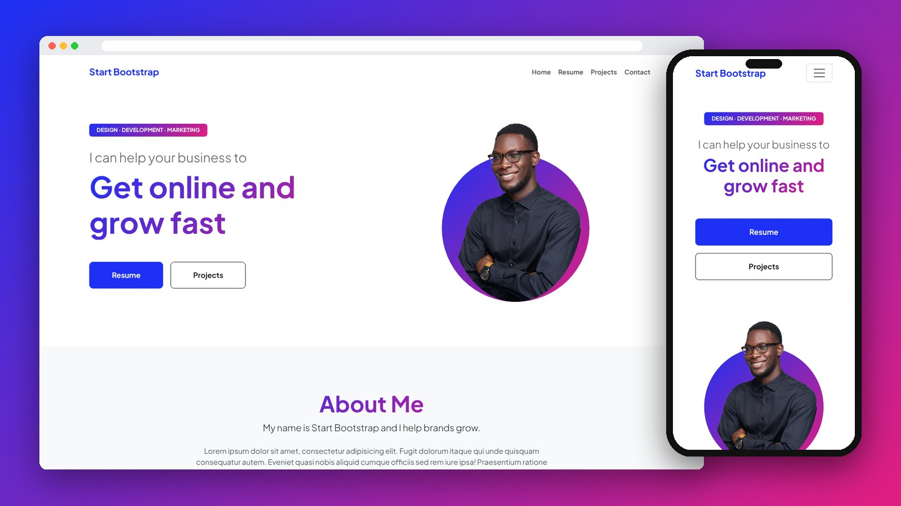

<div align="center">

# Personal Portfolio

A multi-page personal portfolio website, built with Bootstrap 5.

[](https://mo7-adad.github.io/personal/)

    

</div>

---



## Features

- 4 pages: Home, Resume, Projects and Contact
- Gradient text and profile image header
- Resume page with experience, education, skills and languages
- Projects page with cards
- Contact form with Bootstrap form controls
- Responsive navbar with a mobile toggle

## Project Structure

```
personal/
├── index.html
├── resume.html
├── projects.html
├── contact.html
├── style.css
└── images/
```

## Run Locally

```bash
git clone https://github.com/mo7-adad/personal.git
cd personal
```

Then open `index.html` in your browser, or right-click it in VS Code and choose **Open with Live Server**.

## Author

**Mohamed Al-hadad** — Front-End Developer

[](https://github.com/mo7-adad)
